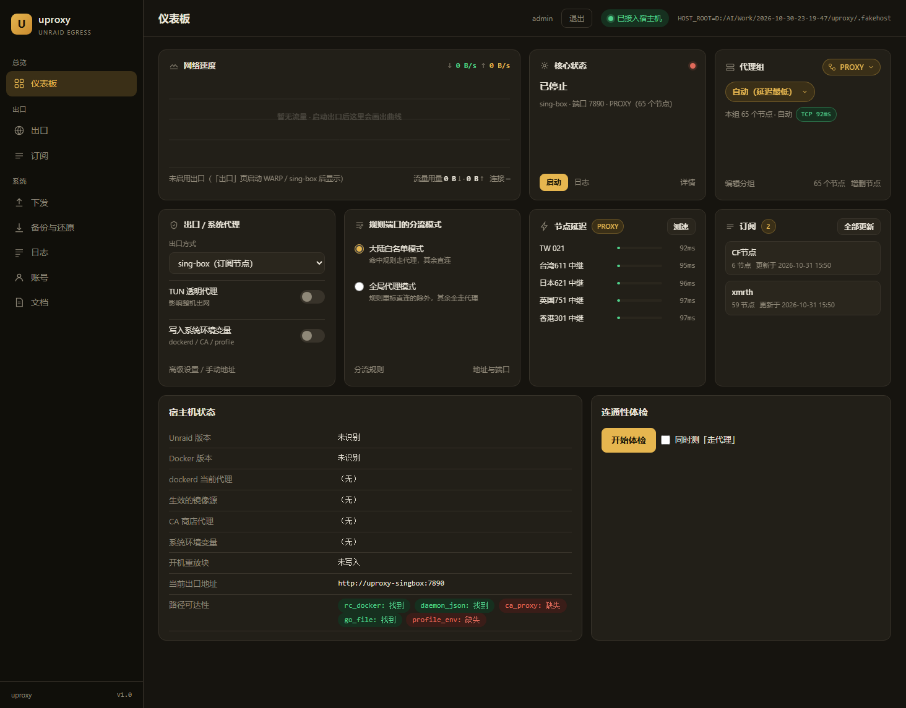
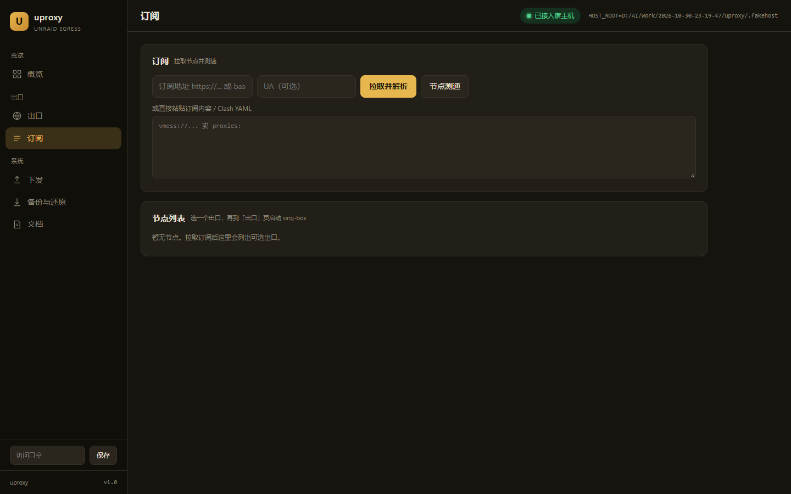
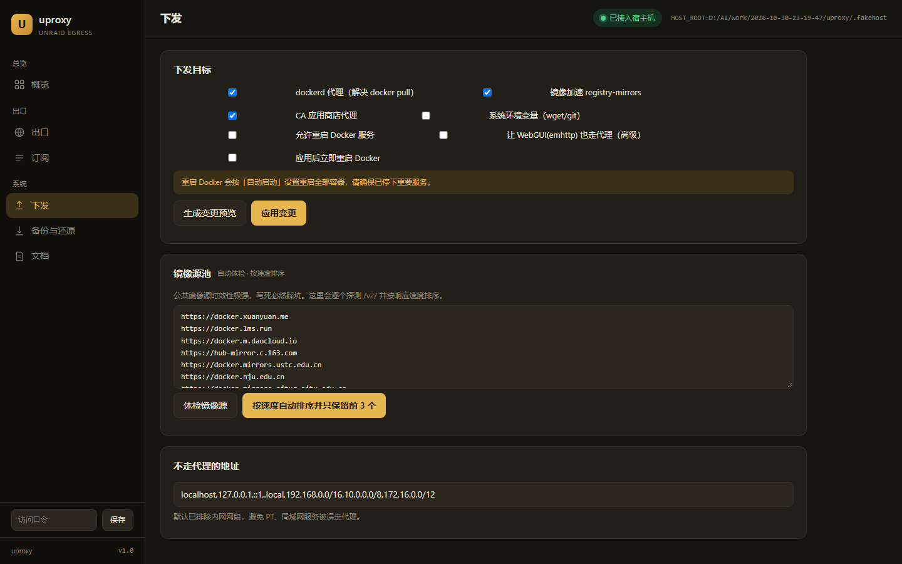
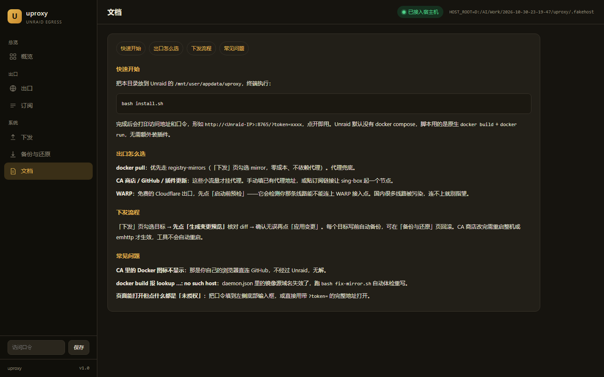

# uproxy · Unraid 出网加速编排工具

解决 Unraid 上 Docker 拉镜像慢/超时、CA 应用商店打不开、插件从 GitHub 更新失败的问题。

它**不是**又一个代理客户端，而是一层**配置编排**：把你选定的出口，
翻译成 Unraid 四个位置各自认识的配置，并负责备份、校验、持久化与还原。

## 为什么需要它

Unraid 上这四个位置互相独立、写法各异、且全在内存里（重启即丢）：

| 目标 | 位置 | 说明 |
|---|---|---|
| `docker pull` | `/usr/local/etc/rc.d/rc.docker` 的 `nohup $UNSHARE ...` 行 | 注入 `env http_proxy/https_proxy`，只影响 dockerd，不干扰其他容器网络 |
| 镜像加速 | `/etc/docker/daemon.json` 的 `registry-mirrors` | 走国内镜像站，不需要代理 |
| CA 应用商店 | `/boot/config/plugins/community.applications/proxy.cfg` | `port=` / `tunnel=` / `proxy=http://或socks5://`，改完需重启才生效 |
| 系统出网 | `/etc/profile.d/uproxy.sh` + `/boot/config/go` | 覆盖 wget / git / 插件下载 |

全部改动会同步写入 `/boot/config/go` 的托管块，开机自动重放。

## 快速开始

三种方式任选其一，**推荐方式一**（Unraid 默认不带 docker compose，方式二需要你先装 Compose 插件）。

### 方式一：一键脚本（推荐）

```bash
# 把整个项目目录传到 Unraid 上，然后：
chmod +x install.sh && ./install.sh
```

脚本会自动：建目录 → 拷源码 → 装 Unraid 容器模板 → `docker build` →
生成随机登录密码 → 启动容器。不依赖 docker compose。

卸载：`./uninstall.sh`（会先提示你去 WebUI 移除开机重放块并还原文件）。

### 方式二：docker compose

```bash
mkdir -p /mnt/user/appdata/uproxy && cd /mnt/user/appdata/uproxy
docker compose up -d --build
```

### 方式三：Unraid 容器模板

把 `unraid/my-uproxy.xml` 拷到 `/boot/config/plugins/dockerMan/templates-user/`，
再到 Unraid WebUI 的 Docker 页 → Add Container → 模板选 `uproxy`。
（需先把镜像 `docker build -t uproxy:latest .` 出来）

### 访问账号

**强烈建议设置密码**，否则同网段任何人都能改你的 Docker 配置。默认用户名为 `admin`，
密码可用环境变量预设，不设则 `install.sh` 自动生成并打印：

```bash
UPX_PASSWORD="换成你自己的长随机串" ./install.sh
```

打开 `http://<Unraid-IP>:8765`，用「用户名 + 密码」登录（默认 `admin` / 你设的密码）。

## 界面

仿 v2rayA 的深色侧边栏风格（深底 + 金色 accent），左侧分组导航，右侧卡片式内容。









侧边栏分组：**总览**（概览）、**出口**（出口 / 订阅）、**系统**（下发 / 备份与还原 / 文档）。
顶部状态徽章实时显示是否已接入宿主机，右上角显示当前登录用户与「退出」。

### 登录方式：用户名 + 密码

不再用裸 token。首次打开会弹出登录页（仿 v2rayA 的登录框），输入用户名与密码即可；
登录后浏览器自动记住会话，无需再次输入。默认用户名 `admin`，密码由 `install.sh` 打印
（也可通过环境变量 `UPX_PASSWORD` 预设）。老的 `?token=` 直连链接仍可兼容使用。

> 安全提示：这是面向家庭局域网的工具，账户不存在「找回密码」；忘记密码就在 Unraid 终端
> 重新跑一次 `install.sh` 或给容器重设 `UPX_PASSWORD` 后重启。

### 实时流量面板

概览页下方有一块「实时流量」卡片：用 canvas 画的上行 / 下行实时面积图（每 1.5s 刷新），
并显示当前速率、活动连接数、累计收发字节。数据取自出口容器（WARP / sing-box）的真实网络吞吐，
连接数仅 sing-box 提供。在「出口」页启动 WARP 或 sing-box 后，这里才会跳动。

## 出口方案怎么选

| 模式 | 适用 | 说明 |
|---|---|---|
| 不用代理（仅镜像源） | 只想修 `docker pull` | 零成本、零依赖，靠 registry-mirrors |
| 手动填代理地址 | 已有旁路由 / Clash / 机场 | 支持 `http://` 与 `socks5://` |
| Cloudflare WARP | 想要免费出口 | 容器内自动拉起，免费无限流量；出口 IP 是共享段，GitHub 偶有限流 |
| sing-box + 订阅 | 有订阅链接 | 解析订阅 → 生成配置 → 拉起容器，提供 HTTP/SOCKS 混合端口 |

### ⚠️ Cloudflare Workers「前缀反代」不能用

形如 `https://xxx.workers.dev/https://raw.githubusercontent.com/...` 的是**路径前缀式网关**，
它只接受 `GET`、不实现 `CONNECT` 方法，**无法当作正向代理**使用，填进 `proxy.cfg` 或 `http_proxy` 必然失败。

WebUI 的「探测可用性」会自动判定地址属于 `标准正向代理` / `前缀反代` / `不可达`，填错会当场告诉你。

同理，跑在 Cloudflare Workers 上的 vless 节点（路径常带 `?ed=2560`）虽然协议上是正向代理，
但**出口 IP 是 Cloudflare 数据中心共享段**，GitHub / Docker Hub 会限流或风控，
表现为「商店时好时坏、付费代理却正常」。这是 IP 信誉问题，配置层面无解。

### 推荐组合

**docker pull 走镜像源（不碰代理） + CA 商店/GitHub 走代理** —— 这样大流量不走代理，
既省代理流量，也绕开共享出口对大文件的限流。这正是本工具「按目标分别下发」的设计意图。

## 功能

- **体检**：docker.io / ghcr.io / raw.githubusercontent / GitHub API / CA 商店，支持「直连 vs 走代理」对比
- **镜像源池**：内置多个公共源，探测 `/v2/` 后按响应速度排序、剔除失效源（公共源半年一换血，写死必然踩坑）
- **变更预览**：应用前先出 diff，确认后才写入；每次写入自动备份（保留 40 份）
- **幂等**：重复应用不会叠加 `env`；关闭出口会干净地清除注入
- **一键还原**：按目标还原最近一次备份
- **开机重放**：写入 `/boot/config/go` 托管块，重启后自动重建

## 安全设计

- 任何写入前先 `cp` 备份原文件，`rc.docker` 会**保留原有权限位**（否则 Docker 起不来）
- `daemon.json` 解析失败时**拒绝写入**，不会覆盖你的现有配置
- `rc.docker` 找不到 `nohup` 启动行时**跳过**，不冒险改启动脚本
- 重启 Docker 需显式勾选「允许重启 Docker」，且会二次确认（该操作会按自动启动设置重启所有容器）
- 无硬编码密钥；可选 `UPX_PASSWORD` 做访问保护（默认用户名 `admin`）

## WARP 在国内网络的实测（2026-10）

在一台国内家庭宽带上实测，结论**与常见教程的说法不同**，请先看这段再决定要不要用 WARP：

| 检测项 | 实测结果 |
|---|---|
| 当前出口 | 国内，`colo=LAX` |
| 注册接口 | ✅ 通，拿到 free 账户、分配到 172.16.0.2 |
| 接入点域名解析 | ❌ `engage.cloudflareclient.com` → `198.18.224.65`（黑洞段） |
| 换 DNS 能否解决 | ❌ **不能**。114 与 8.8.8.8 返回同一个污染结果，是链路层被劫持 |
| 直连接入点 IP | ✅ 5/7 可达，最快的 `162.159.199.1` 丢包 0%、249ms |
| 到 CF 边缘吞吐 | ⚠️ 约 350 KB/s（≈2.8 Mbps） |

**要点：**

1. WARP 注册下发的 endpoint 是**域名**，而该域名被解析到黑洞 IP —— 按默认配置启动**必然握手失败**。
2. 唯一的绕法是**把接入点钉成 IP**：在「出口」页把预检给出的 IP 填进「接入点 IP」，工具会以
   `--add-host engage.cloudflareclient.com:<IP>` 启动容器，绕开被污染的 DNS（不依赖镜像的环境变量名）。
3. 即使通了：延迟 ~250ms、吞吐 ~350 KB/s。**只够 CA 模板、插件更新、GitHub raw 这类小流量**；
   拿它拉 Docker 镜像一个 500MB 的层要 20 分钟以上 —— `docker pull` 请务必走 registry-mirrors。

所以工具默认把 `mirror` 打开、`dockerd` 代理只作兜底，WARP 定位是**小流量补位**，不是主力出口。

## 已知限制

- **未在任何真实 Unraid 上验证过**。`rc.docker` 的启动行格式随版本变化，首次请务必先用
  「生成变更预览」人工核对 diff 再应用（找不到 `nohup` 启动行时工具会自动跳过，不会盲改）
- WARP 接入点 IP 会随 Cloudflare 调整而变化，预检给出的 IP 可能过一段时间失效，届时重跑预检
- WARP 预检的 `ping` 在部分网络会被 ICMP 限速，丢包率仅供参考，以「验证是否走 WARP」的结果为准
- 容器内无法直接操作宿主机服务，重启 Docker 通过临时特权容器 + `nsenter` 完成
- WARP / sing-box 出口容器**不映射端口到宿主**，只在 `uproxy-net` 网络内按容器名可达
  （避免把无认证的代理暴露到局域网）。其他容器要用，把它也加入 `uproxy-net` 即可
- CA 商店的 `proxy.cfg` 改完后**需要重启 Unraid 或重启 emhttp** 才生效，工具不会自动重启整机
- CA 商店里的 Docker 图标由**你的浏览器**直接访问 GitHub 获取，不经过 Unraid，配代理无效
- 订阅测速是「到节点服务器的 TCP 耗时」，不是真实代理延迟
- 不支持 ssr 等已停止维护的协议，解析时会自动跳过并提示

## 卸载

WebUI「备份与还原」页点「移除开机重放块」，再用还原功能把各文件恢复即可。

## 开发

```bash
python -m pip install -r requirements.txt
python tests/smoke.py        # 在伪造的 Unraid 目录树上跑全流程
python tests/parse_check.py  # 验证订阅解析
```

`tests/smoke.py` 不需要真实 Unraid：它会造一棵假目录树，验证注入幂等性、
权限保留、`daemon.json` 合并、go 托管块去重、还原与卸载。
